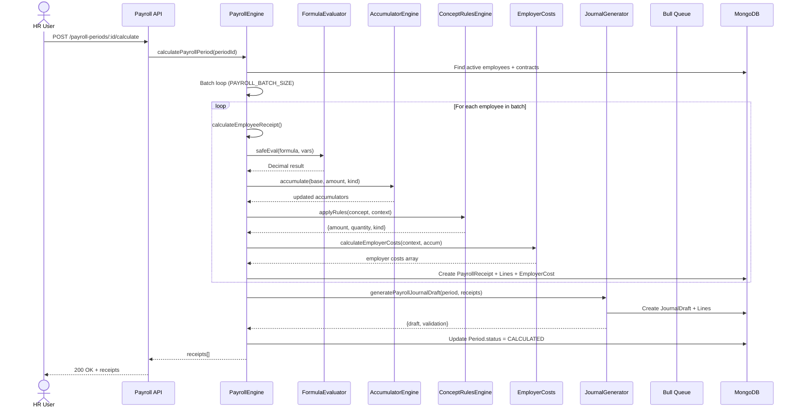
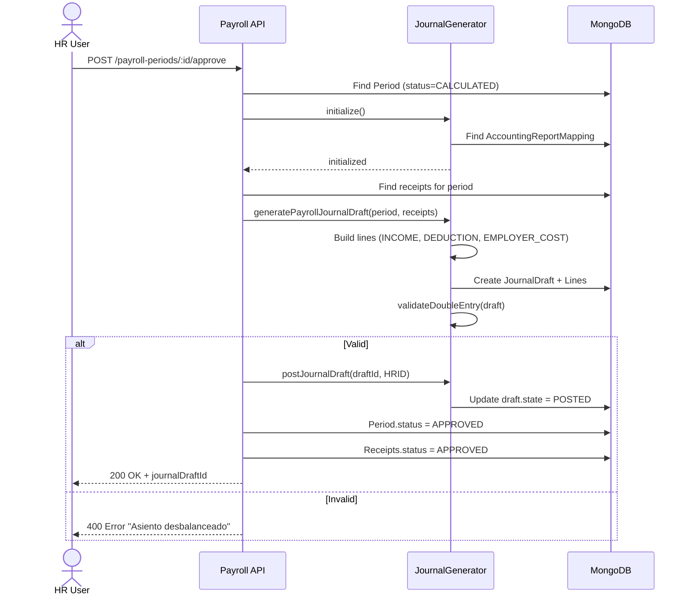
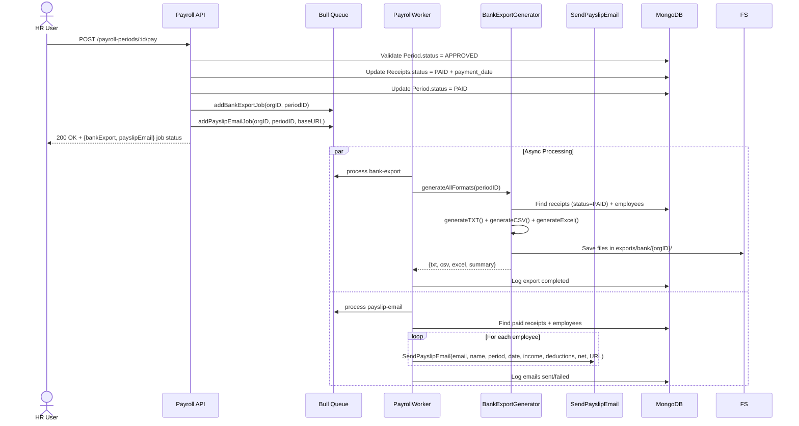
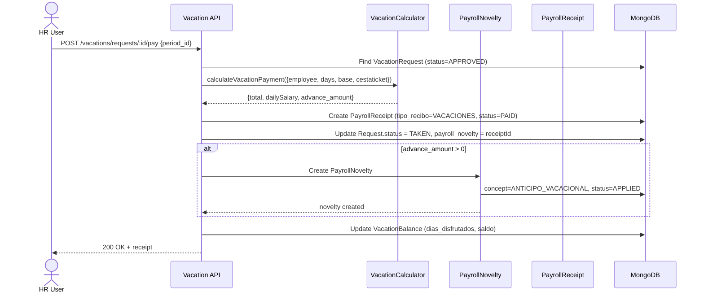
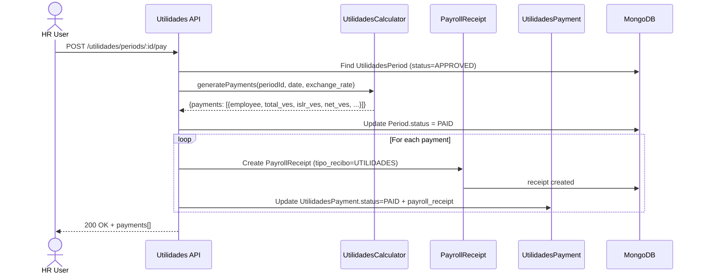
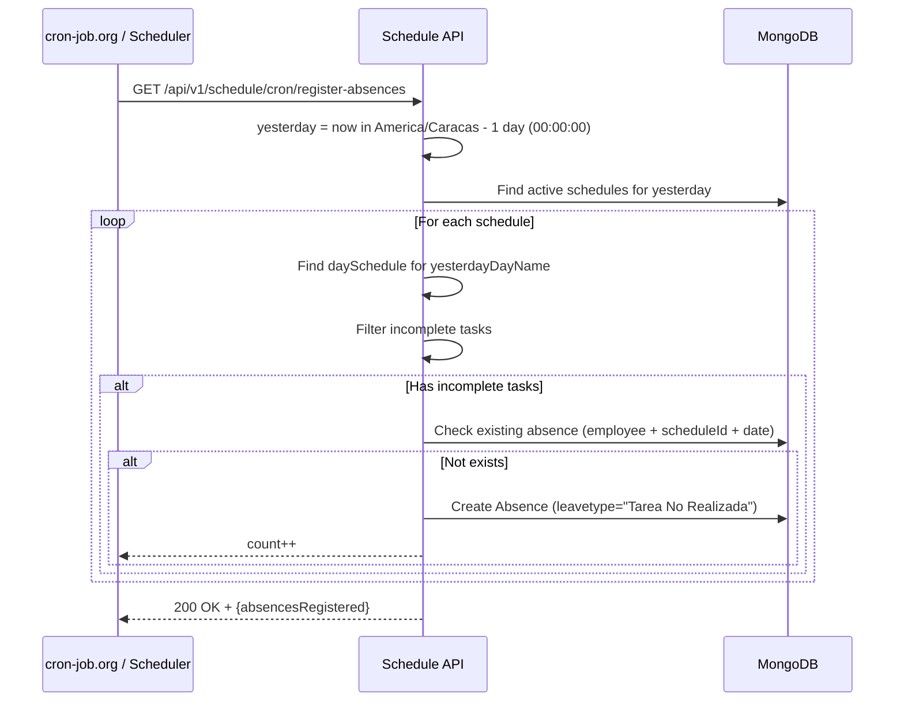

# Flujo de Datos - Módulo de Nómina

## Flujo Principal: Cálculo de Nómina por Período

## Flujo: Aprobación de Período

## Flujo: Pago de Período

## Flujo: Vacaciones → Novedad de Nómina

## Flujo: Utilidades → Recibos de Nómina

## Flujo: CRON - Registro de Ausencias (Timezone Venezuela)

## Variables de Contexto en Fórmulas (FormulaContext)

| Variable | Descripción | Ejemplo |
|----------|-------------|---------|
| `SALARIO_BASE` | Salario base mensual VES | 13000 |
| `SALARIO_DIARIO` | Salario diario (base/30) | 433.33 |
| `SALARIO_HORA` | Salario por hora | 54.17 |
| `DIAS_TRABAJADOS` | Días laborados en período | 15 |
| `H_EXTRA_DIURNA` | Horas extra diurnas | 4 |
| `H_EXTRA_NOCTURNA` | Horas extra nocturnas | 2 |
| `CESTATICKET` | Valor cestaticket del día | 40 |
| `LUNES` | Lunes en período | 2 |
| `DOMINGOS` | Domingos trabajados | 1 |
| `FERIADOS` | Feriados trabajados | 0 |
| `REPOSO_33` | Días reposo 3/3 | 0 |
| `REPOSO_FULL` | Días reposo total | 0 |
| `AUSENCIAS` | Días de ausencia | 1 |

## Reglas de Acumulación (AccumulatorEngine)

| Base | Conceptos que Acumulan |
|------|------------------------|
| `IVSS_BASE` | SUELDO_BASE, COMPLEMENTO, CESTATICKET, H_EXTRA_DIURNA, H_EXTRA_NOCTURNA, BONO_NOCTURNO, DIAS_FERIADO, DOMINGO_TRABAJADO, DIAS_DESCANSO |
| `FAOV_BASE` | Igual que IVSS_BASE |
| `RPE_BASE` | Igual que IVSS_BASE |
| `PRESTACIONES_BASE` | SUELDO_BASE, COMPLEMENTO, CESTATICKET, H_EXTRA_DIURNA, H_EXTRA_NOCTURNA, BONO_NOCTURNO, DIAS_FERIADO, DOMINGO_TRABAJADO, DIAS_DESCANSO, REPOSO_33, REPOSO_FULL |
| `ISLR_BASE` | SUELDO_BASE, COMPLEMENTO, H_EXTRA_DIURNA, H_EXTRA_NOCTURNA, BONO_NOCTURNO, DIAS_FERIADO, DOMINGO_TRABAJADO, DIAS_DESCANSO |
| `INCES_BASE` | Igual que IVSS_BASE |

---

*Documentación de flujo de datos v1.0 | 2026-11-03*