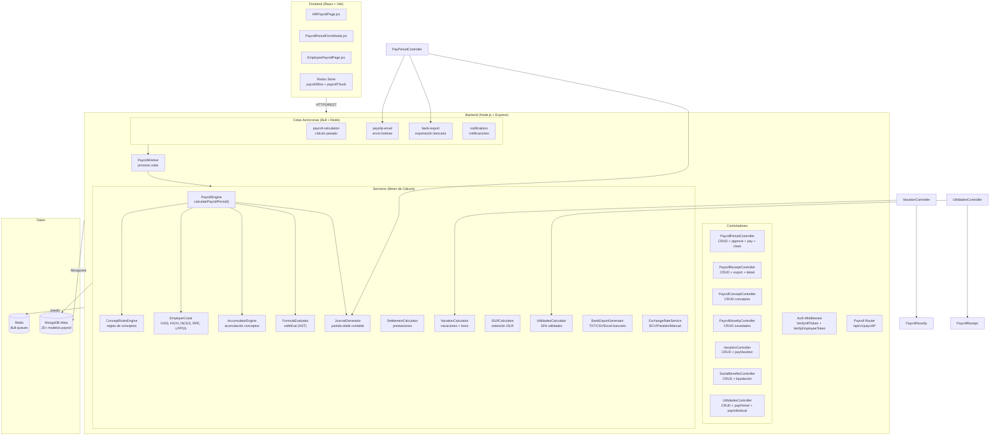

# Arquitectura del Módulo de Nómina Venezolana

## Visión General

El módulo de nómina venezolana implementa el cálculo completo de nómina según legislación venezolana (LOTTT, IVSS, FAOV, INCES, ISLR, RPE, LPPSS, cestaticket, vacaciones, bono vacacional, utilidades, prestaciones sociales, horas extra) integrado en la arquitectura MERN existente.

## Diagrama de Arquitectura General



## Componentes Principales

### 1. Modelos de Datos (25+ modelos)

| Modelo | Descripción |
|--------|-------------|
| `PayrollPeriod` | Período de nómina (quincenal/mensual/semanal) |
| `PayrollReceipt` | Recibo individual de empleado |
| `PayrollReceiptLine` | Líneas de conceptos del recibo |
| `PayrollPolicy` | Configuración legal por organización |
| `PayrollConcept` | 45+ conceptos con fórmulas Nominix |
| `PayrollNovelty` | Novedades (anticipos, préstamos, vacaciones) |
| `PayrollEmployerCost` | Costos patronales por recibo |
| `VacationBalance/VacationRequest` | Saldos y solicitudes de vacaciones |
| `SocialBenefitsLedger/SettlementCalculation` | Prestaciones y liquidación |
| `UtilidadesPeriod/UtilidadesPayment` | Utilidades (15% ganancias) |
| `ISLRRetentionTable` | Tablas SUNAT anuales |
| `AccountSubcategory` | Plan contable (6xxx, 2xxx, 4xxx) |
| `AccountingReportMapping` | Mapeo concepto → cuenta contable |
| `PayrollJournalDraft/Line` | Asientos contables borrador |

### 2. Motor de Cálculo (PayrollEngine)

```
calculatePayrollPeriod(periodId)
  ├── Inicializa estado CALCULATING
  ├── Obtiene empleados activos con contrato vigente
  ├── Procesa en batches (PAYROLL_BATCH_SIZE, default 50)
  │   └── calculateEmployeeReceipt() por empleado
  │       ├── FormulaContext (variables permitidas)
  │       ├── AccumulatorEngine (acumulación bases)
  │       ├── ConceptRulesEngine (reglas: tope, base, fórmula)
  │       ├── EmployerCosts (costos patronales)
  │       └── PayrollReceipt + Lines + EmployerCosts
  ├── generatePayrollJournalDraft() → JournalGenerator
  ├── Valida partida doble (validateDoubleEntry)
  └── Actualiza estado CALCULATED
```

### 3. Evaluador de Fórmulas Seguro (FormulaEvaluator)

- **AST-based** usando `acorn` parser
- **NO usa `eval()` ni `Function()`** → **RCE prevented**
- Operadores permitidos: `+ - * / % **`
- Comparadores: `=== !== < <= > >=`
- Funciones: `min max abs round floor ceil Decimal MIN MAX ABS ROUND FLOOR CEIL`
- Expresiones condicionales: `a ? b : c`
- Lógicos: `&& ||`

### 4. Generador de Asientos Contables (JournalGenerator)

```
generatePayrollJournalDraft(period, receipts)
  ├── 1. INGRESOS (Débito: Gasto 6xxx / Crédito: Por pagar 2xxx)
  ├── 2. DEDUCCIONES (Débito: Por pagar 2xxx / Crédito: Retenciones 4xxx)
  ├── 3. COSTOS PATRONALES (Débito: Gasto 62xx / Crédito: Por pagar 22xx)
  ├── Crea AccountingPayrollJournalDraft + Lines
  └── validateDoubleEntry() → diferencia ≤ 0.01 VES
```

### 4. Flujo de Aprobación y Pago

```
approve() [HR]
  ├── Valida estado = CALCULATED
  ├── JournalGenerator.initialize() → carga mapeos
  ├── generatePayrollJournalDraft(period, receipts)
  ├── validateDoubleEntry() → error si desbalanceado
  ├── postJournalDraft() → estado POSTED
  ├── Period.status = APPROVED
  └── Receipts.status = APPROVED

pay() [HR]
  ├── Valida estado = APPROVED
  ├── Receipts.status = PAID + payment_date
  ├── Period.status = PAID
  ├── addBankExportJob() → bull queue (async)
  ├── addPayslipEmailJob() → bull queue (async)
  └── Response incluye warnings si queues fallan
```

### 5. Colas Asíncronas (Bull + Redis)

| Cola | Concurrencia | Job | Procesador |
|------|--------------|-----|------------|
| `payroll-calculation` | 1 | `calculate` | `calculatePayrollPeriod()` |
| `bank-export` | 2 | `export` | `BankExportGenerator.generateAllFormats()` |
| `payslip-email` | 5 | `send` | `SendPayslipEmail()` batch |
| `notifications` | 10 | `notify` | logging |

**Worker**: Auto-inicia en `server/index.js` → `startPayrollWorker()`

### 6. Tasa de Cambio (ExchangeRateService)

```
getExchangeRate()
  ├── Cache 24h
  ├── Proveedor: BCV API / Paralelo / Manual (EXCHANGE_RATE_PROVIDER)
  ├── Fallback: MANUAL_EXCHANGE_RATE_VES (default 36.0)
  └── Validación: 10 < rate < 100 VES/USD
```

### 7. Seeds Críticos

| Seed | Registros | Propósito |
|------|-----------|-----------|
| `account-subcategory` | 38 | Plan contable nómina (6xxx, 2xxx, 4xxx) |
| `islr-retention-table` | 20 (2024-2025) | Tablas SUNAT para ISLRCalculator |
| `payroll-concepts` | 45+ | Conceptos con fórmulas Nominix |
| `receipt-types` | 8 | NORMAL, VACACIONES, UTILIDADES, etc. |
| `payroll-policy` | 1/org | Parámetros legales VES |
| `holidays` | 30 | Feriados 2024-2025 |

## Contratos de Interfaz

### PayrollEngine → JournalGenerator
```typescript
interface JournalGenerator {
  initialize(): Promise<JournalGenerator>
  generatePayrollJournalDraft(period, receipts): Promise<{draft, lines}>
  validateDoubleEntry(draft): {valid, difference, totalDebit, totalCredit}
  postJournalDraft(draftId, postedBy): Promise<draft>
  reverseJournalDraft(draftId, reversedBy, reason): Promise<draft>
}
```

### FormulaEvaluator
```typescript
function safeEval(formula: string, allowedNames: Record<string, number>): Decimal
function validateFormula(formula: string, allowedNames): {valid, error}
```

### BankExportGenerator
```typescript
generateTXT(): string      // Formato ancho fijo (Banesco, Mercantil, etc.)
generateCSV(): string      // CSV genérico
generateExcel(): string    // CSV + BOM UTF-8
saveFile(content, periodId, format): {filepath, filename, records, totalAmount}
generateAllFormats(periodId): {txt, csv, excel, summary}
```

## Seguridad

- **RCE Prevention**: `Formula()` constructor eliminado, usa `safeEval` AST
- **Auth**: `VerifyHRToken` (HR) + `VerifyEmployeeToken` (Empleado) + `PermissionCheck("payroll:*")`
- **Multi-tenant**: `organizationID` en todos los modelos + queries filtradas por `req.ORGID`
- **CORS**: Regex configurable via `CORS_ORIGIN_REGEX` (Vercel + dominios custom)
- **Rate Limiting**: Bull queue concurrency + `PAYROLL_WORKER_CONCURRENCY`
- **Secrets**: Nunca en logs, `.env.example` documentado

## Deploy y Operación

### Variables de Entorno Críticas
```bash
# Nómina
BCV_API_URL=https://www.bcv.org.ve
BCV_API_KEY=
EXCHANGE_RATE_PROVIDER=bcv
MANUAL_EXCHANGE_RATE_VES=36.0
PAYROLL_WORKER_CONCURRENCY=5
PAYROLL_BATCH_SIZE=50

# Colas
REDIS_HOST=localhost
REDIS_PORT=6379
REDIS_PASSWORD=

# Email
SENDGRID_API_KEY=SG.xxx
SENDGRID_SENDER_EMAIL=noreply@condove.com
```

### Health Check
```
GET /api/health
→ { status, timestamp, services: { mongodb, redis, queues, firebase } }
→ No inicializa Bull, solo verifica estado
```

### Scripts Útiles
```bash
npm run test              # 127 tests passing
npm run seed:payroll      # Ejecuta todos los seeds
npm run create:indexes    # Crea índices en Atlas
node server/workers/payrollWorker.js  # Worker standalone
```

---

*Documentación generada: 2026-11-03 | Versión: 1.0 | Autor: CTO Condominios Venezuela*